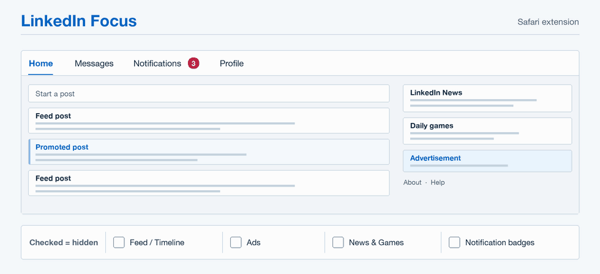

# LinkedIn Focus

LinkedIn Focus is a LinkedIn feed blocker for Safari on macOS. It hides the
feed, promoted posts, the news and games rail, and notification badges so you
can use messaging and profiles without the pull of the timeline. Four
independent popup toggles are on by default. Use **Allowed accounts** to keep
posts from selected people or companies visible in a hidden feed, or use
**Blocked accounts** to hide their posts from the home feed.

[](https://github.com/jjarndt/linkedin-focus/actions/workflows/ci.yml)

> Not affiliated with, endorsed by, or connected to LinkedIn or Microsoft. See
> the [disclaimer](#disclaimer) below.



<p>
  <a href="#try-in-safari"> Try in Safari</a>
  &nbsp;
  <a href="https://jjarndt.github.io/linkedin-focus/" title="Safari guide"></a>
  &nbsp;
  <a href="#quickstart" title="Build with Xcode"></a>
</p>

## Features

Four independent toggles, each applied instantly across all open tabs (no reload)
and persisted in `storage.local`:

- **Feed / Timeline** — hides the home feed. With **Allowed accounts**, it
  shows posts from those authors. Posts from **Blocked accounts** stay hidden
  in both feed modes. Profiles and messaging stay available.
- **Ads** — promoted posts (detected in JavaScript by their label text, German
  and English) plus sidebar advertisements.
- **News & Games** — the "LinkedIn News" module and the daily-games box in the
  right sidebar.
- **Notification badges** — the red counters in the top navigation. The nav
  itself stays fully clickable.

## FAQ

### How do I keep posts from specific accounts visible?

On a LinkedIn profile or company page, open the Safari popup and click
**Allow this account**. In the full feed, the same button appears next to
the author of a post. You can also paste a profile or company URL into
**Allowed accounts** and click **Add**.

Turn on **Feed / Timeline** to keep posts from allowed accounts visible in the
hidden feed. The **Ads** toggle still controls promoted posts from those accounts.

### How do I hide posts from specific accounts?

On a profile or company page, open the Safari popup and click **Block this
account**. In the full feed, the same button appears next to the author. You
can also paste a LinkedIn profile or company URL into **Blocked accounts** and
click **Add**. Blocking takes precedence if an account is on both lists.

Both lists apply to posts LinkedIn loads into your home feed. Safari stores
the lists locally and applies changes without reloading LinkedIn. To take an
account off either list, click **Remove** next to its entry in the popup.

### Can I block LinkedIn ads without hiding the feed?

Yes. Turn on **Ads** and turn off **Feed / Timeline** in the Safari toolbar
popup. This hides promoted posts and sidebar ads while keeping the feed visible.

## Scope

LinkedIn Focus hides distractions on LinkedIn in Safari on macOS. The home
feed filter can show or hide posts from selected people and companies.

## Non-Goals

These are things LinkedIn Focus deliberately does not do. They are not open
TODOs, they are decisions — proposals for them are closed without further
discussion.

- **No Chrome or Firefox build.** The shipped artifact is a Safari app
  extension. The build step is Apple's `safari-web-extension-converter` invoked
  with `--macos-only`, and `sync.sh` only knows how to find the Resources
  directory inside the generated Xcode project. The sources use plain
  WebExtension APIs (`globalThis.browser ?? globalThis.chrome`) and may well
  load elsewhere, but nothing here is built, signed, or verified against another
  browser.
- **No user-configurable selectors.** The extension defines its selectors
  in `extension/content.js` and `extension/styles.css`. `storage.local` holds
  the four toggle values and the allowed and blocked account paths.
- **No network access and no telemetry.** The extension uses the `storage`
  permission for settings and account paths. The extension code makes no
  network requests.
- **No App Store distribution.** Signing is local free provisioning with a
  Personal Team, as described under [Signing & running](#signing--running).
  Store distribution needs a paid membership and a review process; building it
  yourself from source is the intended path.

If one of these boundaries is in the way of a concrete use case, a fork is the
right way forward. The license explicitly allows it.

## Try in Safari

You can try LinkedIn Focus on macOS without Xcode.

1. [Download the Safari ZIP](https://github.com/jjarndt/linkedin-focus/releases/latest/download/linkedin-focus-safari.zip).
2. In **Safari → Settings → Advanced**, enable **Show features for web developers**.
3. In the **Developer** tab, click **Add Temporary Extension**, confirm the
   unsigned extension prompt if Safari shows it, and select the ZIP.
4. Open LinkedIn, click **LinkedIn Focus** in the Safari toolbar, and allow it
   to run on the site.

Safari removes a temporary extension after 24 hours or when you quit Safari.
For a local build that persists across restarts, follow the [Xcode quickstart](#quickstart).

## Quickstart

macOS with Safari and Xcode installed. From nothing to a generated Safari
project:

```sh
git clone https://github.com/jjarndt/linkedin-focus.git
cd linkedin-focus

xcrun safari-web-extension-converter extension \
  --project-location SafariProject \
  --app-name "LinkedIn Focus" \
  --bundle-identifier com.example.linkedinfocus \
  --macos-only --no-open --copy-resources
```

Pick your own reverse-DNS bundle identifier instead of `com.example.*`. This
writes the `SafariProject/` Xcode project (gitignored) from the contents of
`extension/`.

The remaining steps happen in Xcode and Safari and are described under
[Signing & running](#signing--running): select your Personal Team on both
targets, `Cmd-R`, then enable the extension in Safari's settings and allow it on
`linkedin.com`.

## How it works

- **Manifest V3.** The popup writes toggles to `storage.local`. A nonpersistent
  background page serializes account-list edits from the popup and feed. The
  content script reacts to storage changes and applies the hiding rules from
  `styles.css`.
- **No feed flash.** The content script and stylesheet are injected at
  `document_start`, so hidden elements never paint.
- **JS-flagged elements.** Where LinkedIn offers no stable CSS anchor, promoted
  posts and right-rail modules are detected in JavaScript (a `MutationObserver`
  plus a `popstate` rescan; SPA navigations are picked up via the DOM swap they
  cause) and flagged with `.lf-ad` / `.lf-news`.
- **Two DOM shells.** LinkedIn serves either a newer React shell (feed, profiles)
  or a classic Ember shell (messaging). Both selector sets are kept, so whichever
  is served, one of them matches.

Only the `storage` permission and access to `*.linkedin.com` are requested. No
network calls, no data collection, no tracking.

### Debug logging

If a selector drifts and something stops being hidden, enable match logging on
`linkedin.com`:

```js
localStorage.setItem('lfDebug', '1');
```

Then watch the console for `[LinkedIn Focus]` messages explaining what matched
and why.

## Project layout

```
extension/            # the extension source (a plain WebExtension)
  manifest.json
  _locales/en         # English UI strings
  shared.js           # feature table (defaults), loaded by content script + popup
  content.js
  styles.css
  popup/popup.html | popup.css | popup.js
  icons/icon-48 | 128 | 512.png
SafariProject/        # generated by the converter (gitignored)
sync.sh               # rsync extension/ -> SafariProject Resources
```

## Requirements

- macOS with Safari
- Xcode (from the App Store)
- A free Apple ID for local code signing (no paid developer account needed)

## Build

The same command as in the [Quickstart](#quickstart), with its context: it wraps
the WebExtension in a Safari app container using Apple's converter. Pick your own
reverse-DNS bundle identifier:

```sh
xcrun safari-web-extension-converter extension \
  --project-location SafariProject \
  --app-name "LinkedIn Focus" \
  --bundle-identifier com.example.linkedinfocus \
  --macos-only --no-open --copy-resources
```

This creates the `SafariProject/` Xcode project (gitignored) from the contents of
`extension/`.

## Signing & running

1. Open `SafariProject` in Xcode.
2. For **both** targets — the app **and** the extension — go to
   **Signing & Capabilities**, enable **Automatically manage signing**, and
   select your **Personal Team** (your free Apple ID).
3. **Build & Run** (`Cmd-R`). The container app launches.
4. In Safari, open **Settings → Extensions**, enable **LinkedIn Focus**, and
   allow it on `linkedin.com` (choose **Always Allow**).

Free provisioning keeps the extension active across Safari restarts, but the
signature expires periodically. If the extension disappears, re-run `Cmd-R` in
Xcode to re-sign it.

## Usage

Click the toolbar icon to open the popup and flip any of the four toggles. **On =
hidden (focus).** Changes take effect immediately in every open LinkedIn tab and
are remembered.

## Iterating on the extension

`extension/` is the source of truth. After editing files there, sync them into
the generated Safari project's Resources directory:

```sh
./sync.sh
```

Then reload the extension in Safari. If you generated the Xcode project before
v1.2.0, copy `extension/background.js` into the generated extension's
`Resources` directory and add it to the extension target's **Copy Bundle
Resources** before syncing. You can also generate a fresh project.

## Packaging a release

Update the version in `extension/manifest.json`, `package.json`, and
`package-lock.json`. After merging, push a matching `vX.Y.Z` tag. Download
`linkedin-focus-safari.zip` from the successful [Safari ZIP workflow](https://github.com/jjarndt/linkedin-focus/actions/workflows/safari-zip.yml)
run for that tag and attach it to the GitHub release.

## Disclaimer

This is an independent, unofficial project. It is **not** affiliated with,
endorsed by, sponsored by, or connected to LinkedIn or Microsoft in any way.
"LinkedIn" is a trademark of Microsoft Corporation. The extension reads profile
and company paths from supported pages and filters posts in your browser.
Settings and both account lists stay on your device. Changes to LinkedIn's page
structure can affect detection.

## License

MIT — see [LICENSE](LICENSE).
